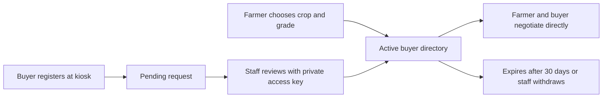

# Visible grades, buyer directory and guarded source automation

17 October 2026. This update follows the user's revised requirement: buyer registration and contact discovery are now in scope. Farmer registration, online sales and buyer offer prices remain out of scope.

## Farmer journey

Language → crop → market → dated reference → visible A/B/C cards → potential buyers for that exact crop and grade.

Each card now has a distinct photo-style quality/freshness example and a Potential buyers button, replacing the old per-grade SMS action. Reference values remain A +4%, B base, C −5.5%; they are not buyer offers. Grade cards are no longer collapsed. Dry grain/beans are shown with quality differences, not ripeness. Fresh cassava/leaves show freshness differences. The images are AI-generated illustrations, not official quality classifications, inspection results or food-safety certificates. Quality terms must be agreed with the buyer; official A/B/C mapping remains unvalidated.



## Buyer registration

Use Register as buyer in the footer or I want to buy this crop from the buyer list. Supply buyer/business name, location, one crop and requested grade. No price field is accepted by the API. Buyers negotiate directly with farmers outside the app.

Publication requires explicit consent. Public phone contact is optional and has its own opt-in; without it, the phone is not stored and the listing directs farmers to kiosk staff. Names, locations and requested crop/grade become public only after staff approval. Farmers need neither a phone nor a registration to see the directory.

New requests are pending. Staff can approve/reject them and withdraw active listings. Listings expire 30 days after approval. Only active, unexpired exact crop/grade matches are returned, alphabetically, without paid ranking. Kiosk review is not a guarantee of identity, ability to pay, demand or a completed sale. The directory starts empty; no fake buyers were seeded. More contacts can create alternatives, but the app does not claim it has eliminated middleman market power.

The public form has a configurable per-client daily limit (default 100 for shared kiosks). Client addresses are hashed with the server secret; raw addresses are not stored by this feature. An upstream gateway should add proper deployment-level rate limiting before a public rollout.

## Staff access and local setup

Run:

```powershell
.\.venv\Scripts\python.exe tools/configure_local.py
.\.venv\Scripts\python.exe -m uvicorn app.main:app --app-dir backend --host 127.0.0.1 --port 8000
```

The setup script creates a random staff key in ignored `.env` only if none/placeholder exists and enables a daily source check. It never prints the key or commits it. The local instance has been configured. The server's `.env` contains ADMIN_TOKEN for an authorised operator to use in Kiosk staff → Staff access key. The app does not display or persist the key; it is entered as a password and cleared when the staff view is removed or the inactivity reset runs. Do not send the key to other people or include it in screenshots.

Buyer review and manual source refresh reject default or short keys and require a constant-time matching access key. Public setup preferences are still local-only and unprivileged. Buyer contact and source-management responses are no-store; buyer contacts are never saved in the kiosk's localStorage or service-worker cache. Business data is stored in the local SQLite database, which is ignored by Git. Use HTTPS, managed secrets, operator authentication, tenant boundaries and database backup/migrations before a real shared deployment; this is a local hackathon integration, not a production security certification.

## Automated source refresh

The official WFP/HDX Uganda CSV was retrieved live and checked. The actual file contained 34,328 CSV rows (including its tag row), 4,327,511 bytes, and its latest observation date was 15 August 2026. After the same Northern Uganda/crop/unit filtering, the live importer formed 5,934 monthly groups and 82 latest crop/market records. The source check successfully published these records to the local database. See `source-refresh-live-check.json` for the checksum, timestamp, record counts and model metadata. Its latest month remains August 2026: automation does not create newer observations.

The application checks the official metadata URL and its exact Uganda resource URL. HDX redirects downloads to a signed AWS URL; only its observed HTTPS host and exact Uganda object path are accepted. All redirect destinations are revalidated. Signed query credentials are neither logged nor retained in audit evidence.

The automatic repeat check returned `no_new_observations` and preserved the dataset; see `source-refresh-repeat-check.json`. This demonstrates a successful repeated check rather than manufacturing a new date or publishing duplicates.

Validation includes byte/row limits, fixed schema, supported crop/region, UGX/kg, actual/aggregate flags, finite positive bounded prices, valid coordinates, no future observation dates, complete crop coverage, no per-series date regression, and a coverage-loss guard. No arbitrary source URL, prompt, executable code, browser scraping session or remote model pickle is accepted.

## What the tiny AI model does

A local IsolationForest with 32 trees is trained on 5,585 adjacent-month log price changes from the committed processed data. It audits suspicious proposed changes; it does not scrape web pages, generate prices or select buyers. Multi-month changes are normalised to a monthly log rate for its input. A separate deterministic guard also flags changes above a 1.75 ratio in either direction, and source price-type transitions require review.

Fetcher/parser → strict validation → small anomaly auditor → transactional database publication → source audit record.

Flagged batches are held with `review_required`; schema/network/coverage failures preserve the previous dataset and produce a failed audit record. There is no automatic override for a suspicious batch. An analyst must investigate the source and importer; a source-review publication workflow is future work. The auditor is a conservative development guard trained on the team's processed data, not a validated fraud/accuracy detector.

Publication and its audit entry commit together. A restart does not overwrite newer published database data with the bundled older ML snapshot. Newly fetched price rows do not inherit stale model forecasts; live source refresh is separate from forecast retraining. Existing forecast-model metrics remain tied to the team's original training dataset.

The in-process scheduler runs on startup and then every 86,400 seconds **while this server is running**, with a per-process lock against overlapping manual/scheduled checks. Run one worker for this local demo. Cloud cron, distributed locking, automatic deployment and remote kiosk fleet management are not implemented.

## API and verification

- GET `/api/buyers?crop=beans&grade=B`: public active exact-match directory, no offer price.
- POST `/api/buyers/register`: consented registration, initially pending; rejects unexpected fields including prices.
- GET `/api/buyers/manage`, POST `/api/buyers/{id}/review`: staff-key protected review/withdrawal.
- GET `/api/source/status`: scheduler and last audit summary.
- POST `/api/source/refresh`: staff-key protected fixed-source check.

Backend checks cover consent, moderation, exact matching, expiry, withdrawal, private phone non-retention, no price field, registration limits, URL rejection, permitted official redirect, atomic successful import, restart preservation, suspicious-data hold and failed-import preservation. DOM checks cover all six crop flows, distinct grade panels, directory/registration forms, existing market/date/offline handling and staff tools. No real buyer was registered or contacted by tests; buyer tests use isolated in-memory databases.

Verification result: 65 backend tests passed; all six DOM crop-to-buyer journeys passed. The in-app browser also confirmed visible grade cards, different freshness images, an honest empty-buyer state and a registration form containing crop/grade but no offer-price field. See `grades-buyers-preview.png`.
